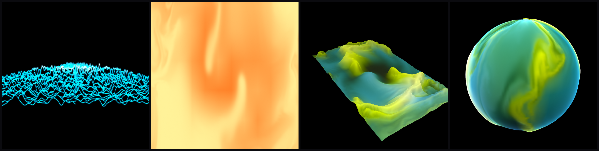

# vibe-apps

Apps built on the [vibe](https://github.com/kolbbond/vibe) engine.



- **vvavviz**: a music visualizer. Point it at a track or at live audio and it
  draws spectra, pitch and a music-driven fluid "plasma". See
  [vvavviz/README.md](vvavviz/README.md).
- **vibe-launcher**: a full-screen launcher for the vibe apps and games in a
  build's `games.json`, on the desk or on a TV (Hyprland).

## Just want to run vvavviz?

Prebuilt downloads (a Linux AppImage and a Windows zip) are on the way and will
appear on the [Releases](https://github.com/kolbbond/vibe-apps/releases) page.
Until then, build from source on Linux as described below.

## Build from source (Linux)

vibe-apps builds against a `vibe` checkout next to it, at the engine release this
version of the apps was built with (`v0.002.4`):

```bash
git clone --branch v0.002.4 --recurse-submodules https://github.com/kolbbond/vibe.git
git clone https://github.com/kolbbond/vibe-apps.git
make -C vibe deps          # third-party libraries (slow, once)
cd vibe-apps
make                       # = cmake --preset linux && cmake --build build
make test
build/bin/vvavviz --plasma -i
make install               # -> ~/.local (bin, share/vvavviz, lib/vibe); PREFIX=/usr/local to change
make uninstall             # removes what the last install wrote
```

The system packages vibe needs are listed in its README.

Against an installed engine instead (`cmake --install` in vibe):

```bash
cmake -S . -B build -G Ninja -DVIBE_ROOT= \
      -DCMAKE_PREFIX_PATH=<prefix> -DVIBE_DEPS_PREFIX=<vibe>/.deps/usr
cmake --build build
```

## License

MIT, see [LICENSE](LICENSE).
