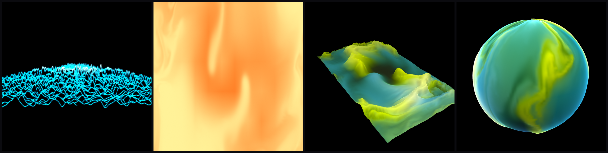

# vvavviz

An audio visualizer and fluid plasma playground for the vibe engine.

## Run

    build/bin/vvavviz                       # live input (default device)
    build/bin/vvavviz path/to/track.wav     # play and visualize a file, then the rest of its folder
    build/bin/vvavviz path/to/album/        # play through a folder (recursive, sorted by path)
    build/bin/vvavviz --plasma -i           # plasma, full screen, live input
    build/bin/vvavviz --plasma --preset lava path/to/track.wav

The launcher starts vvavviz with
`--plasma -i`. To visualize desktop audio in live mode, open *Audio Visualizer →
Audio Devices* and pick the "Monitor of …" input.

Flags: `-i` live input, `-d N` input device, `-l` list devices, `--plasma`,
`--preset NAME|PATH`, `--mute` (analyze a file but play silence),
`--screenshot out.ppm --frames N` (writes frame N before the ImGui pass, then quits).

## Music Browser

*View → Music Browser* lists every audio file under a folder (default `~/Music`, or the
folder of the file you started with). Double-click to play; **<< Prev** / **Next >>** step
through the list, and with **Auto-advance** on (default) a finished track starts the next one.
Files that fail to decode are skipped. The playing track is shown in green.

## Plasma

*View → Plasma*. A real-time 2D fluid (the vibe engine's `Vibe::Fluid`) that the music pushes around:

| Emitter | Listens to | Does |
|---|---|---|
| Burst | kick hits | outward ring of force, white-hot flash |
| Vortex | sub level | whirlpool around the center |
| Jets | mid level | two orbiting jets, faster with the tempo |
| Splash | snare hits | splash at a random (seeded) spot |
| Sparks | hat level | scatter of tiny bright dots |
| Glow / Hue | loudness / key | glow amount; palette follows the dominant pitch |

- Left-drag stirs the fluid and right-drag paints dye (on the image, or on the
  background in background mode).
- Everything is tunable live in the panel.
- *Save preset* writes `presets/<name>.json`. `neon`, `lava` and `aurora` ship with it.
- Unknown keys in a preset file are errors, which is how typos are caught.
